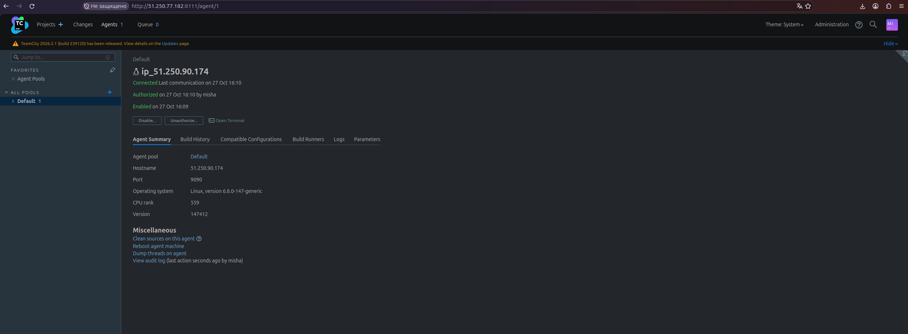
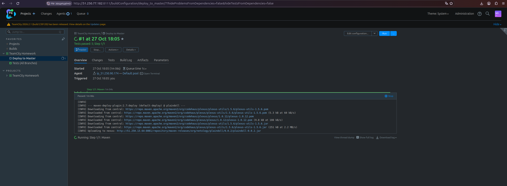
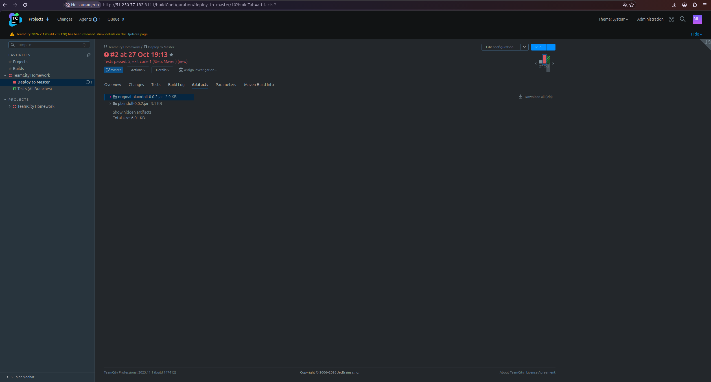
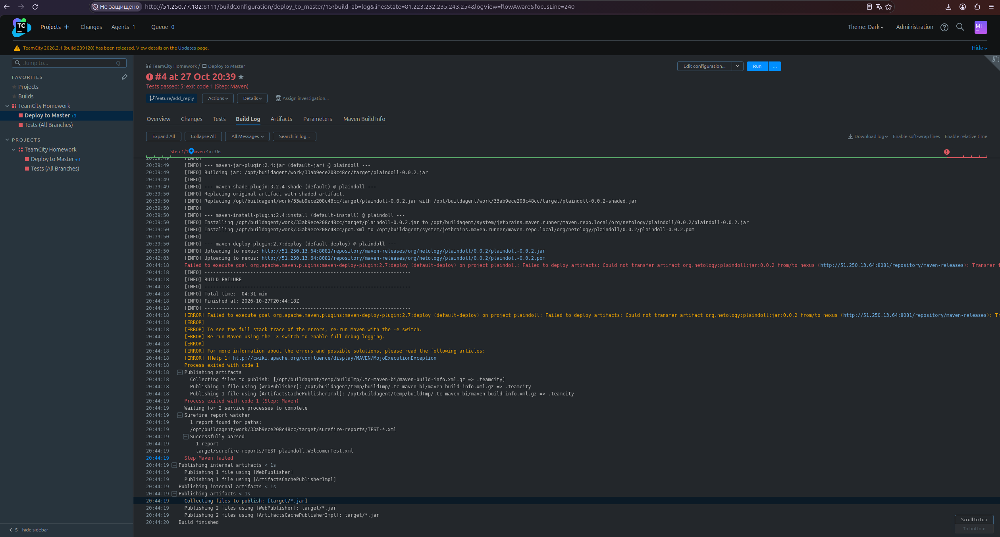
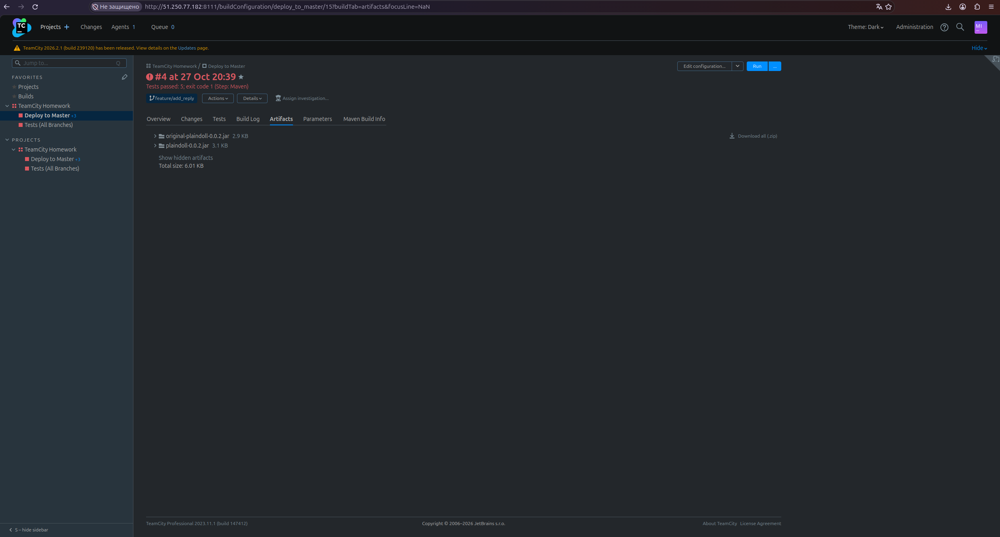

# Решение ДЗ TeamCity

## Исходники
- Репозиторий
- Ветка master
- Ветка feature/add_reply

## Конфигурация TeamCity
- Проект: TeamCityHomework
- Конфигурация сборки: Deploy to Master (ID: TeamCityHomework_deploy_to_master)
- Branch-based логика:
  - master → mvn clean deploy
  - feature/* → mvn clean test (через отдельную конфигурацию или branch spec)

## Настройки Maven и Deploy
- settings.xml загружен в TeamCity (параметры конфигурации).
- distributionManagement в pom.xml настроен на Nexus (http://51.250.13.64:8081/...).
- ID сервера в settings.xml: nexus.

## Результаты сборок
- Сборка feature/add_reply: Тесты прошли (5 passed), артефакт .jar собран.
- Сборка master (после мерджа): Тесты прошли, deploy запущен.
- Примечание: Этап deploy завершился ошибкой Connection timed out к Nexus — это инфраструктурная проблема, конфигурация сборки и код корректны.

## Versioned Settings (DSL)
- Статус: Cannot find previous revision of project.

## Скриншоты

## Ссылка на репозиторий
[https://github.com/Chehlov1M/example-teamcity.git](https://github.com/Chehlov1M/example-teamcity.git))
